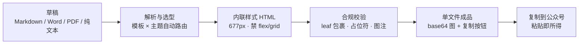

# dong-skill

> TD 的 AI 工具 skill 集合仓库。每个 skill 独立顶级子目录，克隆后按需安装。


## 包含的 Skill

| Skill | 说明 | 版本 |
|---|---|---|
| [gzh-skill/](gzh-skill/) | 微信公众号文章排版（合并版）：Markdown/Word/PDF/纯文本 → 可直接粘贴公众号编辑器的内联样式 HTML。统一入口内含两套引擎——**design 引擎**（原 gzh-design-skill：主题组件库 + 主题生成器 + 校验脚本）与 **wx 引擎**（原 wxskill：模板 × 主题 + 产出归档），按请求自动路由 | v1.0.0 |

> 2026-09-08 起，原 `gzh-design-skill/` 与 `wxskill/` 两个顶级目录已合并为 `gzh-skill/`（两套引擎分别移入其 `engine-design/` 与 `engine-wx/`，内容原样保留）。合并决策与升级方式见 `DEV_NOTES.md`。

---

## 功能



- **双引擎自动路由**：design 引擎管主题组件与生成器，wx 引擎管模板骨架与产出归档；说「公众号排版」即按请求路由，无需关心内部结构。
- **15 套模板 × 12 套主题 = 180 种组合**，另有 `preview/` 预览画廊一屏对比，选中即用。
- **多格式输入**：Markdown / Word(.docx) / PDF / 纯文本草稿，或直接贴截图与推文链接。
- **微信兼容铁律**：全部内联样式，禁 `flex / grid / var() / 伪元素 / 外链样式表`，统一 677px 栏宽——微信编辑器清洗后不塌版。
- **合规校验器**：`validate_gzh_html.py` 强制 `<span leaf="">` 文本包裹、拦截残留 `{{占位符}}`、核对图文数量，不合格不许交付。
- **单文件交付**：图片一律 base64 内嵌，成品自带右上角「复制到公众号」按钮，一个文件走完全程。
- **配图体系**：图片内嵌正文对应位置、图下不写字；推文双语呈现（带图推文 = 高清截图 + 图下中文，纯文字推文 = 自制双语卡片）；超长图自动套可滑动容器；DPR≥2 高清截图，模糊图不交付。
- **写稿口径库**：四腔口吻（新智元 / 卡兹克 / 量子位 / ASI）+ 开篇样例 + 范文语料；官方 / 媒体 / 社区口径分开标注，参数附适用条件。
- **每日 AI 热点流水线**：触发词一喊，选题 → 信源核验 → 截图裁切 → 3 篇成稿 → 排版落盘 → 信源台账，全链路可回溯。
- **茶内容专线**：9 套茶模板 + 节气/节令元素五件套 + 茶知识核验口径，涉及茶自动调用。

## 风格

**模板（15 套，按系列）**

| 系列 | 模板 | 气质 |
|---|---|---|
| 科技简约 | `minimal-tech` `cyber-card` `terminal-code` `hud` | 细线、大留白、数据面板、终端风 |
| 大模型速写 | `ai-model` | 元信息条 + 关键数字条 + 官方截图就位 |
| 文艺长文 | `wechat-pai-essay` | PingFang + 字距 + 微信绿，品牌叙事 |
| 茶系列 | `tea-notes` `tea-almanac` `tea-festival` `tea-culture` `tea-scroll` `tea-essay` `tea-ware` `tea-catalog` `tea-industry` | 宋体标题 + 图录式细线留白，历书/手卷/图录多形制 |

**主题（12 套色板）**：极简白 / 极简黑 / 科技蓝 / 赛博绿 / 霓虹紫 / 淘宝闪购 / 微信派 / AI 实验室 / 茶席 / 茶志 / 千问 / DONGPro极简科技（默认）。

**效果**：粘贴进公众号编辑器即得与预览一致的成品——字号、字距、留白、细线、宋体标题全部保留；长图可框内滑动；英文帖图文对照不重复；文内无大标题、无灰字导语、无页脚，干净收尾。

## 可用工具

| 类别 | 工具 / 命令 |
|---|---|
| AI 会话 | OpenCode · Claude Code · Codex · Cursor · Gemini CLI · Copilot · Windsurf（`AGENTS.md` / `SKILL.md` 自动读入） |
| 斜杠命令 | `/gzh-skill` 排版 · `/zaobao` 每日热点 · `/chamo` 茶模型 |
| 自然语言触发 | 「公众号排版」「gzh」「自动排版」「wechat-typesetting」「早报」「每日 3 篇」「茶模型」 |
| 脚本工具链 | `inject_images.py` 图文注入 · `wrap_preview.py` 包装复制按钮 · `validate_gzh_html.py` 合规校验 · `xshot.ps1` 高清截图 · `bands.py`/`crop.py` 裁切 · 主题生成器 · PIL 双语卡片合成 |
| 平台 | Windows · macOS · Linux（一键安装脚本 `install.ps1` / `install.sh`） |

## 快速开始

```bash
git clone https://github.com/webzol/dong-skill.git

# 方式一：一键脚本（复制到 Claude Code / Codex 等 skill 目录）
bash dong-skill/gzh-skill/install.sh                    # macOS / Linux
powershell -File dong-skill\gzh-skill\install.ps1       # Windows

# 方式二：手动
mkdir -p ~/.claude/skills
cp -R dong-skill/gzh-skill ~/.claude/skills/gzh-skill
```

安装后重启 AI 会话生效。详见 [gzh-skill/SKILL.md](gzh-skill/SKILL.md)。

### 每日 AI 热点（3 篇/天）

在本仓库目录里对 AI 说 **`早报`** / **`今天的热点`** / **`每日 3 篇`** / **`按每日流程跑`**，或运行 **`/zaobao`**，或直接贴 X「Today's News」截图，即按 [`gzh-skill/engine-wx/DAILY_NEWS_WORKFLOW.md`](gzh-skill/engine-wx/DAILY_NEWS_WORKFLOW.md) 跑完整流程。

- 成品：`E:\WX\<日期>\`（可在工作流 §0.2 改），备份 `generated/<日期>/`
- 信源台账：`docs/sources/<日期>.md`（哪个数字/哪张图 ← 哪个 URL 的哪一块）
- 没有触发词不会自动跑；换机器只需改 §0.2 里的三处路径

---

## 更新日志

> 详细决策与踩坑记录见 [DEV_NOTES.md](DEV_NOTES.md) 与各 skill 内部 DEV_NOTES。

### 2026-11-18

- **茶模板扩容**：新增 `tea-festival`（节令茶单：节假日茶俗）与 `tea-industry`（行业观察：新茶上市 / 价格行情 / 政策标准 / 展会财报，口径行必带）；`tea-almanac` 节气条目升为一等组件。
- **节气与节令元素五件套**：`components.md` §16——节气签 / 节日题签 / 三候条 / 季签 / 当令茶提示条；不写宜忌吉凶，候名以《月令七十二候集解》为准。
- **快讯模式**：限时稿件流程入 `DAILY_NEWS_WORKFLOW.md` §0.3；高清图片 + 高清截图双铁律同步生效，快讯不豁免。

### 2026-11-17

- **推文双语呈现体系**：带配图推文 = DPR2 高清截图（说话部分，无时间行/互动栏）+ 图下只烧中文；纯文字推文 = 无水印双语卡片（真实头像 + 英文黑字中文灰字）；emoji 一律保留原样。
- **长图滑动铁律**：显示高度超约 2000px 或高宽比 > 4 的成品图自动套可滑动容器，交付前滑动自测。
- **图下翻译区留白**：图-分隔线 36px / 线-文 44px / 底部 60px 定版；里程碑稿可用叙事场景开篇。

### 2026-10-30

- **配图改版**：取消 12px 灰色图注，图下不写任何文字；长截图优先切段嵌入。
- **废除文末页脚**：不写「品牌 · 产品 · 状态 · 日期」行，正文最后一句即结束。

### 2026-09-08

- **双引擎合并**：`gzh-design-skill/` + `wxskill/` → `gzh-skill/`（`engine-design/` + `engine-wx/`），统一入口与触发词。

### 初始版本

- **v1.0.0**：微信公众号内联样式排版 skill，模板 × 主题组合、预览画廊、一键安装脚本。

---

## 维护约定

- 根目录 `DEV_NOTES.md` 记录架构决策、升级流程、踩坑，**接手前必读**
- 每个 skill 独立顶级子目录，命名小写、连字符
- gzh-skill 内：engine-design 走 upstream import 流程升级（remote 已配好），engine-wx 从 `E:\wxskill`（webzol/WXSKill）快照同步进来，原仓库是开发主目录
- **改完必须提交推送**：改稿/改规则 → 重新生成 → 台账 → 回写规则 → `commit` + `push`，回复报 commit 短号
